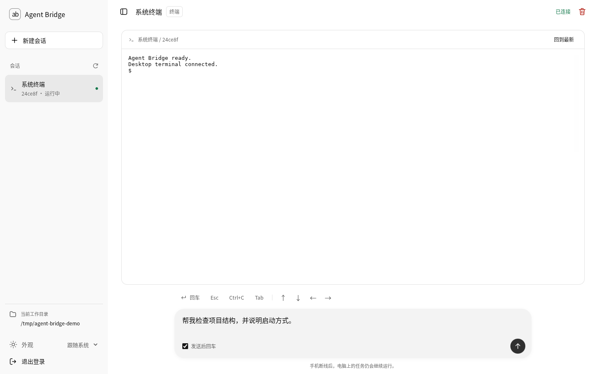
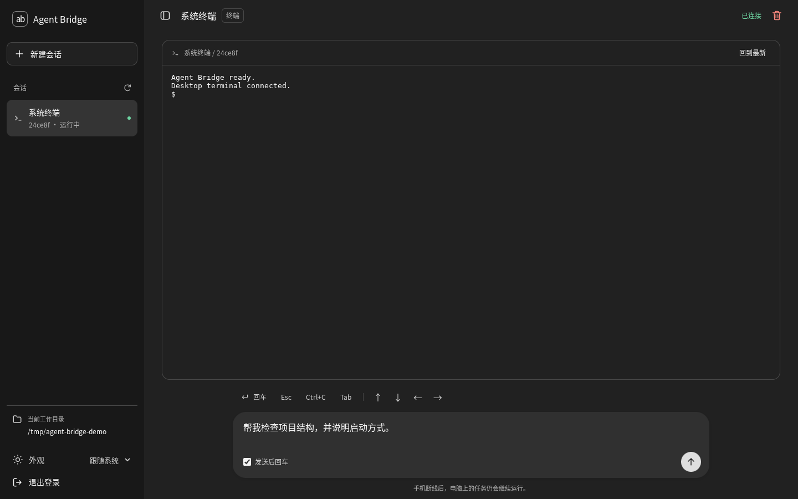
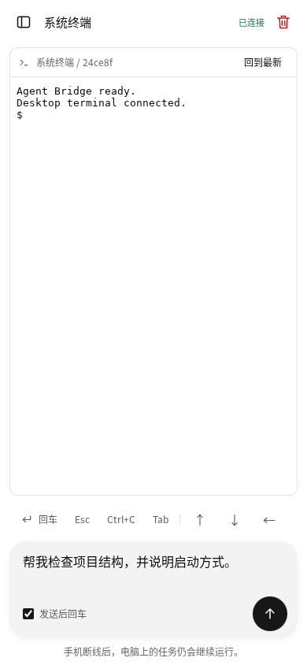

# Agent Bridge

通过手机浏览器控制电脑上的 Codex、Claude Code 和系统终端。电脑保留真实 PTY 进程，手机通过 Cloudflare Tunnel + WebSocket 收发终端数据，无需家庭公网 IP。


## 界面预览

以下为实际运行截图，展示系统终端会话。

**桌面端 · 浅色主题**




**桌面端 · 深色主题**



**手机端 · 390px 窄屏布局**




## 本版界面更新（0.2.0）

- 登录页改为简洁中性布局，工作区使用会话侧栏、真实终端和底部输入框。
- 支持浅色、深色、跟随系统；主题只存储在当前浏览器，访问密钥不写入浏览器存储。
- 桌面侧栏可折叠，窄屏使用可关闭的会话抽屉；快捷键条可横向滑动。
- 点击“新建会话”选择 Agent；空白工作区也可直接点选 Codex、Claude Code 或系统终端。
- 每个会话分别保留当前页面里的未发送草稿；刷新页面后草稿不保留。
- 输入框支持 Ctrl/Cmd+Enter 发送，普通 Enter 换行，输入法组合期间不触发快捷发送。
- 关闭会话前显示确认框；Ctrl+C 仍是独立的终端快捷键。
- 连接服务、访问密钥、Cloudflare Tunnel 和原生 Agent 的启动方式延续上一版。后端只新增主题脚本的静态文件路由。

解压后进入 `agent-bridge` 目录，仍按下面的命令启动。若旧版正在运行，换新版前先正常结束 Agent 会话并停止旧服务；内存会话不会迁移。

## 能做什么

- 手机新建 Codex / Claude Code / 系统终端会话，实时显示带颜色的终端输出。
- 单字符、中文、多行输入；取消“发送后回车”可只发文本，再按“回车”提交。
- Esc、Ctrl+C、Tab、方向键，以及直接在终端打字。
- 同一台电脑可从手机或电脑浏览器访问同一个会话。
- 手机断线不会停止任务；重连获取最近的终端输出。
- 密钥登录、HttpOnly Cookie、同源校验；服务仅监听 127.0.0.1。
- 所有前端依赖本地提供，不依赖手机访问第三方 CDN。

## Windows 快速开始

### 1. 安装环境

安装 Node.js 22 或 24 LTS，确保你需要的 `codex` / `claude` 已安装并在本机完成登录。可在 PowerShell 验证：

```powershell
node --version
npm.cmd --version
codex --version
claude --version
```

只使用其中一种 Agent，不需要安装另一种。安装 Cloudflare Tunnel 客户端：

```powershell
winget install --id Cloudflare.cloudflared --exact
```

安装后重新打开 PowerShell。可从 [Cloudflare 官方下载说明](https://developers.cloudflare.com/cloudflare-one/networks/connectors/cloudflare-tunnel/downloads/) 获取客户端。

### 2. 安装项目依赖

将压缩包解压，例如得到 `D:\AgentBridge\agent-bridge`，在该目录执行：

```powershell
cd D:\AgentBridge\agent-bridge
npm.cmd ci
```

### 3. 启动电脑端，指定要操作的项目目录

```powershell
$env:BRIDGE_CWD = 'D:\Projects\YourProject'
npm.cmd start
```

保持窗口运行。启动后显示：

```text
Agent Bridge: http://127.0.0.1:8787
Workspace: D:\Projects\YourProject
Access key (keep private): 一串随机密钥
```

先用电脑浏览器打开 `http://127.0.0.1:8787`，输入密钥，选择“系统终端”并点“新建”，验证输入和输出。

也可使用启动脚本：

```powershell
.\start.ps1 -Workspace 'D:\Projects\YourProject'
```

如果执行策略不允许运行脚本，直接使用上面的环境变量和 `npm.cmd start` 即可，不需要修改全局执行策略。

### 4. 新开一个 PowerShell 窗口，启动隧道

```powershell
cloudflared tunnel --url http://127.0.0.1:8787
```

或者在项目目录执行 `npm.cmd run tunnel`。等待输出一个 `https://某个随机名称.trycloudflare.com` 地址。

### 5. 手机连接

1. 手机使用移动数据，打开上一步的 HTTPS 地址。
2. 输入**电脑端服务窗口**显示的访问密钥。
3. 选择 Codex 或 Claude Code，点击“新建”。
4. 等待 Agent 启动，输入内容，点击“发送”。
5. 如需只发 `y` 而不提交，取消勾选“发送后回车”，输入 `y` 并发送；需提交时点击“回车”。

电脑浏览器也打开同一网址、选择同一个会话，就能看到手机发来的内容。Agent 的终端输出位于网页里；启动服务的 PowerShell 窗口显示服务信息。

持有密钥者可操作你的终端，等同拥有该系统账户的命令执行权限，请仅自己使用。使用 Agent 正常的权限确认机制；项目不传入跳过审批或沙箱的参数。

## macOS / Linux

```bash
npm ci
BRIDGE_CWD=/absolute/path/to/project npm start
# 另开终端（先安装 cloudflared）
cloudflared tunnel --url http://127.0.0.1:8787
```

Linux 若需要编译 node-pty，需要 Python 3、make、g++；macOS 需要 Xcode Command Line Tools。参见 [node-pty 官方说明](https://github.com/microsoft/node-pty)。

## 已有 Codex 会话如何继续

软件无法直接附着到任意已打开 PowerShell 的现有进程。先在网页新建“系统终端”，然后在其中输入你本机 CLI 支持的恢复命令（例如从 `codex --help` 或 `claude --help` 查询 resume / continue），在 CLI 的会话选择器中选中原会话。

这样继续的是 Agent 保存的会话记录；不是把原终端的进程迁移过来。不要让两个进程同时修改同一工作区的同一任务。

## 配置

| 环境变量 | 默认值 | 说明 |
| --- | --- | --- |
| `BRIDGE_CWD` | 启动时所在目录 | 所有新会话的工作目录，必须存在 |
| `PORT` | `8787` | 仅绑定 127.0.0.1 |
| `BRIDGE_TOKEN` | 每次启动随机生成 | 可选固定密钥，至少 24 字符 |

固定密钥示例（PowerShell）：

```powershell
$env:BRIDGE_TOKEN = '请替换为你自己的至少24字符随机密钥'
$env:BRIDGE_CWD = 'D:\Projects\YourProject'
npm.cmd start
```

密钥只用于登录，不放进 URL、不写入 localStorage，也不注入新终端环境。Cookie 登录有效期 12 小时；重启服务会清空登录。退出登录会断开该登录的网页连接，但不停止任务。

## 运行边界

- Quick Tunnel 是临时测试入口，重启隧道通常会变更地址。长期使用应配置固定域名的命名隧道，可叠加 Cloudflare Access。参见 [Quick Tunnels 官方说明](https://developers.cloudflare.com/tunnel/get-started/quick-tunnels/)。
- 电脑必须联网且不休眠；服务和 cloudflared 两个进程都需持续运行。
- 仅手机断线时任务保留；停止服务会结束它管理的终端。暂不提供服务重启后的进程恢复或开机自启动。
- 最多保留 6 个会话，退出的会话也计数；可用“关闭当前会话”清理。
- 最近约 2 Mi 个 JavaScript 字符的原始终端输出存于内存。超出后丢弃旧片段，不提供完整审计记录；极长输出或窗口尺寸改变后，全屏 TUI 的历史重放可能不完全还原，可在终端内触发重绘。
- 多设备可同时输入，最后调整窗口的设备决定终端尺寸；目前没有单写入者抢占锁。
- 断线后禁用发送，不自动重发输入，以免重复执行；发送后如果立即断线，需要自己查看终端确认 Agent 是否收到。
- Cloudflare 的可达性取决于电脑和手机所在网络，程序不保证每个网络都能连接。
- 暂不提供文件上传、后台推送、原生手机 App、桌面托盘或 EXE 安装包。

## 常见问题

**npm ci 在 Windows 编译失败**：node-pty 包含原生模块。优先使用 Node.js LTS；若没有匹配的预编译文件，需要 Python 3 和 Visual Studio Build Tools 的 Desktop development with C++ 工作负载。若提示 Spectre 库缺失，按错误信息补装相应 MSVC Spectre 组件。

**新建 Agent 后立即退出**：先在本机普通终端运行 `codex` 或 `claude`，检查安装、PATH、登录、代理和订阅。Windows 后端使用 `cmd.exe /d /s /c codex` 或 `claude`，支持 npm 的 `.cmd` 启动器；仅在 PowerShell profile 中定义的别名不生效。可先开“系统终端”诊断。

**手机能打开页面但无法连接终端**：检查 cloudflared 日志、HTTPS 是否正确，以及反向代理是否支持 WebSocket Upgrade。不要用 HTTP 公网入口传密钥。命名隧道应转发到 `http://127.0.0.1:8787`。

**Quick Tunnel 无法创建**：检查本机 `.cloudflared` 下是否存在与 Quick Tunnel 冲突的配置；不要删除已有配置，按官方文档改用已有的命名隧道或单独隔离配置。

**端口占用**：例如设置 `$env:PORT = '8788'` 再启动，并将隧道目标同步改为 `http://127.0.0.1:8788`。

## 验证与开发

```bash
npm test
```

集成测试创建真实 PTY 并验证：登录认证、同源限制、非法 Agent 拒绝、命令执行、中文输出、单字符输入、窗口尺寸校验、断开后任务存活、离线输出重放、会话删除与退出登录。

结构：`server.mjs` 为本机服务，`public/` 为手机界面，`scripts/tunnel.mjs` 为隧道启动器，`test/` 为集成测试。没有修改 Codex 或 Claude Code，也没有额外调用模型 API。
